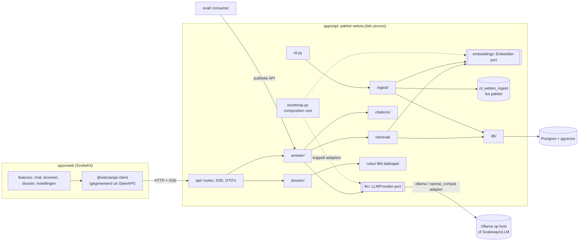

# 06. Architectuur en structuur: microservices of niet?

*Onderzocht op 30-10-2026. Bouwt voort op [02](02-ai-architectuur.md) en [04](04-tech-stack.md). Op `main` staat sinds e90712b (PR #37) al het monorepo-skelet.*

## Besluit (TL;DR)

**Geen microservices.** Wetvia wordt een **modulaire monoliet** met harde, automatisch gecontroleerde grenzen. Hij draait als **een paar processen** uit één codebase:

| Proces | Wat | Waarom apart |
|---|---|---|
| `web` | SvelteKit | Andere taal en runtime |
| `api` | FastAPI (`wetvia`-pakket) | De kern |
| `worker` | **Hetzelfde** `wetvia`-pakket, maar via de CLI (`wetvia ingest …`, `wetvia embed`) | Batchwerk mag de chat niet vertragen |
| `db` | Postgres 16 + pgvector | Eén database |
| *inference* | Ollama op de host, of Scaleway/vLLM in cloudmodus. **Niet onze code**, aangesproken via HTTP | Draait op GPU/Metal. Dit is de enige echte "service"-grens |

Waarom zo:

- Bronnen uit 2026 zijn het eens: kleine teams (1-5 ontwikkelaars) beginnen met een (modulaire) monoliet. Je splitst pas af bij een **gemeten** reden: een ander resourceprofiel, isolatie, of teams die elkaar blokkeren [1][2][3][4].
- Een AI-inference-workload met andere hardware is precies de uitzondering die die bronnen noemen [3]. Bij Wetvia zit die al buiten de deur: Ollama draait native, want Docker op macOS heeft geen toegang tot Metal [9].
- Een solo-ontwikkelaar met 5-10 uur per week en €0-25 per maand kan geen tracing, gateways, sagas of meerdere deploys onderhouden. Een "distributed monolith" is het slechtste van twee werelden [1].
- Voor agents is een **kleine module met een smalle publieke API en eigen tests** belangrijker dan een netwerkgrens. Dat bereik je in-process goedkoper.
- **Portfolio:** "modulaire monoliet met ports & adapters, import-contracten in CI, getypt OpenAPI-contract en een onderbouwd extractiepad" is een sterker verhaal dan vijf containers zonder reden.

## Architectuur



### Backend: "hexagonaal-light" per feature-module

- **Feature-modules, geen technische lagen bovenaan.** Elke capability is een subpakket van `wetvia`:
  - **`ingest`:** schrijfpad, bronnen → chunks.
  - **`retrieval`:** leespad, hybride zoeken.
  - **`rules`:** regels-als-code.
  - **`citations`:** de verifier.
  - **`answer`:** de RAG-use-case.
  - **`dossier`:** documenten genereren.
  - **`llm`** en **`embeddings`:** ports.
  - **`api`** en **`cli`:** ingangen.
  - **`core`:** gedeelde types (`Peildatum`, `ChunkRef`, fouten).
- **Ports & adapters alleen waar het iets oplevert** [5]. Dat is bij externe I/O of meerdere implementaties:
  - `LLMProvider` (Ollama, OpenAI-compatibel, Fake);
  - `Embedder` (sentence-transformers, later TEI/Infinity, Fake);
  - `Retriever` (pg-hybride, Fake);
  - `DsoClient`.
  
  `rules` en `citations` zijn **pure functies** zonder I/O. Die hebben geen port nodig.
- **Composition root:** alleen `bootstrap.py` leest `Settings` en kiest de adapters. Lokaal versus cloud is één env-wissel (`LLM_PROVIDER`). Modules krijgen hun dependencies mee via de constructor of FastAPI-`Depends`. Ze lezen nooit zelf de env.
- **Publieke API per module:** wat in `__init__.py` staat, mag een andere module gebruiken. De rest (`_internal`, `adapters/`) niet.
- **Data-eigenaarschap:** één schema, met tabellen per module in `db/schema/`. `ingest` schrijft `regeling/toestand/chunk`, `retrieval` leest ze alleen.
- **`nl_wetten_ingest`** blijft een los, herbruikbaar pakket onder Apache-2.0. Het kent `wetvia` niet. Alle bron-clients (BWB, CVDR, TK, DSO) horen daar.
- **`eval/`** is een consumer van de publieke API (`wetvia.answer`, `wetvia.retrieval`). **`training/`** valt *buiten* de uv-workspace: torch en Unsloth botsen met de API-dependencies, en workspaces delen één lockfile [7].

### Grenzen afdwingen (in CI, niet op goed vertrouwen)

1. **import-linter** [6]. De lagen gaan van hoog naar laag. Met `|` worden modules in dezelfde laag ook onderling onafhankelijk:
   ```toml
   [tool.importlinter]
   root_package = "wetvia"
   include_external_packages = true

   [[tool.importlinter.contracts]]
   name = "Lagen"
   type = "layers"
   layers = [
     "wetvia.bootstrap",
     "wetvia.api | wetvia.cli",
     "wetvia.answer | wetvia.dossier | wetvia.documents",
     "wetvia.retrieval | wetvia.ingest | wetvia.citations | wetvia.rules | wetvia.llm",
     "wetvia.embeddings | wetvia.db",
     "wetvia.core",
   ]

   [[tool.importlinter.contracts]]
   name = "Domeinkern zonder I/O"
   type = "forbidden"
   source_modules = ["wetvia.rules", "wetvia.citations", "wetvia.core"]
   forbidden_modules = ["sqlalchemy", "httpx", "openai", "fastapi", "sentence_transformers"]
   ```
   Een laag die in het contract staat, moet bestaan [6]. Daarom zet een kleine vervolg-PR alle modules nu al neer als lege subpakketten (elk met `__init__.py` en `AGENTS.md`). Zo staat het contract er vanaf dag één, en vult elk issue alleen zijn eigen module in.
2. **Een apart uv-workspace-pakket alleen waar het herbruikbaar is** (`nl-wetten-ingest`). Losse pakketten geven namelijk *geen* runtime-importisolatie in een gedeelde venv [7]. import-linter is dus de echte bewaker, en meer pakketten levert vooral overhead op.
3. **Contract API ↔ web.** FastAPI exporteert OpenAPI 3.1 [8]. `packages/api-client` bevat `openapi.json`, met daarop types van `openapi-typescript` en een client van `openapi-fetch` (6 kB, werkt met SvelteKit) [10]. De SSE-eventmodellen (`sources`, `answer`, `error`, `done`) worden als components in de OpenAPI-spec opgenomen. CI genereert de spec opnieuw en faalt bij een diff.
4. **mypy strict en tests per module** (`tests/unit/<module>/`, `tests/integration/` met Postgres). Fakes voor elke port staan in `wetvia/<module>/testing.py`.
5. **AGENTS.md** [11]: één in de root (commando's, grenzen, verboden) plus een korte per module. Daarin staan het doel, de publieke API, de toegestane imports en het testcommando. Agents lezen het dichtstbijzijnde bestand.

## Mappenstructuur (doel)

```
wetvia-ai/
├─ AGENTS.md                      # NIEUW: regels voor agents
├─ pyproject.toml                 # uv-workspace (al op main)
├─ package.json / pnpm-workspace.yaml   # + packages/api-client
├─ docker-compose.yml             # db, api, web, worker (profiel)
├─ docs/{01..06}.md, docs/adr/0002-modulaire-monoliet.md
├─ apps/
│  ├─ api/
│  │  ├─ pyproject.toml           # + import-linter-contracten
│  │  ├─ src/wetvia/
│  │  │  ├─ bootstrap.py          # composition root: Settings → adapters
│  │  │  ├─ config.py             # pydantic-settings (alleen bootstrap leest dit)
│  │  │  ├─ core/                 # types, fouten, peildatum (geen I/O)
│  │  │  ├─ api/                  # app.py (factory), routes/, schemas/ (DTO's + SSE-events)
│  │  │  ├─ cli.py                # Typer: ingest, embed, eval-hooks
│  │  │  ├─ answer/               # pipeline.py, schema.py (AnswerV1), prompts/
│  │  │  ├─ citations/            # verifier.py, abstentie (puur)
│  │  │  ├─ retrieval/            # ports.py, hybrid.py, rrf.py, adapters/pg.py
│  │  │  ├─ ingest/               # service.py (nl_wetten_ingest → db), sync
│  │  │  ├─ embeddings/           # ports.py, adapters/sentence_transformers.py
│  │  │  ├─ llm/                  # ports.py, adapters/{ollama,openai_compat,fake}.py
│  │  │  ├─ rules/                # bbl_dakkapel.py (puur)
│  │  │  ├─ dossier/              # schema.py, renderers/{docx,pdf,md}.py, templates/
│  │  │  ├─ documents/            # v0.2: upload, redactie, Docling in subprocess
│  │  │  └─ db/                   # engine, session, schema/, alembic/
│  │  └─ tests/{unit/<module>/, integration/, e2e/}
│  └─ web/src/lib/
│     ├─ features/{chat,sources,dossier,settings}/  # component + store + test per feature
│     ├─ ui/                      # shadcn-svelte
│     └─ (api-client via @wetvia/api-client)
├─ packages/
│  ├─ nl-wetten-ingest/           # Apache-2.0, kent wetvia niet (al op main)
│  └─ api-client/                 # NIEUW: openapi.json + gegenereerde TS-types/client
├─ eval/                          # uv-member "wetvia-eval", gebruikt alleen publieke API
└─ training/                      # eigen pyproject/venv, BUITEN de workspace
```

## Docker Compose

- **Standaard** (`docker compose up`): `db`, `api`, `web`.
- **`worker`** onder het profiel `ingest`: hetzelfde image als `api` met `command: ["sh", "-c", "wetvia ingest sync && wetvia embed"]`. Je draait hem handmatig, of nachtelijk via cron of een GitHub Action [12].
- **`ollama`** onder het profiel `gpu-linux`: alleen voor de RTX 3070 onder Linux of WSL. Op de Mac draait Ollama native [9]. `api` gebruikt `LLM_BASE_URL`, dus host, container en cloud zijn uitwisselbaar.
- Geen gateway, queue of service mesh. De SSE-chat loopt direct naar `api`.

## Pad naar afsplitsen (alleen bij een gemeten reden)

| Volgorde | Kandidaat | Trigger | Hoe, zonder herschrijven |
|---|---|---|---|
| 0 | Inference | Al extern | Andere adapter of `LLM_BASE_URL` (Ollama → vLLM/Scaleway) |
| 1 | Embeddings | Het `api`-image wordt te zwaar (torch), of GPU-delen | Een nieuwe `Embedder`-adapter tegen TEI/Infinity via HTTP |
| 2 | Documentparsing (Docling) | Onvertrouwde input, zwaar, crashgevoelig | `documents` achter een port; de adapter roept een sandboxed worker-container aan |
| 3 | Ingest-worker | Een eigen schema of schaal | Is al een apart proces; alleen het deploy-artefact splitsen |

`rules`, `citations`, `answer` en `retrieval` blijven in-process: daar is geen andere schaal of runtime en geen isolatie-eis. Een module komt pas in aanmerking voor extractie als haar publieke API een tijd stabiel is gebleven [4].

## Gevolgen voor main en de issues

**Main (na PR #37, e90712b):** het skelet klopt in grote lijnen: een virtuele uv-workspace, `apps/api` en `packages/nl-wetten-ingest`, en de pnpm-workspace. Er is geen revert nodig. Eén kleine vervolg-PR (nieuw issue in M0, vóór #3) regelt de rest:

1. **Lege modules erbij:** `core`, `ingest`, `embeddings`, `citations` en `documents`, plus `bootstrap.py` en `cli.py`. Pas `test_subpackages_import` daarop aan.
2. **`import-linter` in de dev-group**, met de contracten hierboven in `apps/api/pyproject.toml`. `uv run lint-imports` komt in de CONTRIBUTING-commando's.
3. **`AGENTS.md`** in de root en per module. Daarnaast `docs/adr/0002-modulaire-monoliet.md`.
4. **Ruff-config op één plek:** die staat nu dubbel in de root en in beide members. Laat de members `extend = "../../pyproject.toml"` gebruiken.
5. **`training/` buiten de workspace** houden en dat in de README vastleggen.
6. **Package-map voor de client:** `packages/api-client` (of `packages/*`) toevoegen aan `pnpm-workspace.yaml` zodra het client-issue start.

## Issues die moeten veranderen

Elke issue-body krijgt een korte sectie **Structuur (docs/06)**:

- **#2 Compose:** een `worker`-service onder profiel `ingest` (zelfde image als api, `sh -c "wetvia ingest sync && wetvia embed"`), een optionele `ollama`-service onder profiel `gpu-linux`, en `LLM_BASE_URL` in plaats van een hard ingestelde Ollama-URL.
- **#3 FastAPI-skelet:** een app-factory in `api/app.py`, routes in `api/routes/`, en `bootstrap.py` als composition root. Modules lezen nooit zelf Settings.
- **#4:** alleen de frontendmappen naar `src/lib/features/<feature>/`.
- **#5 LLM-provider:** `llm/ports.py` en `llm/adapters/{ollama,openai_compat,fake}.py`. De factory gaat naar bootstrap.
- **#7 CI:** stappen voor `lint-imports` en de OpenAPI-check, en afzonderlijke jobs per pakket.
- **#8, #9, #24, #31:** alle bronclients (BWB, DSO toepasbare regels, DSO Presenteren, PDOK) horen in `nl_wetten_ingest`, en dat pakket mag `wetvia` niet importeren. Caching en opslag horen in `wetvia.ingest`.
- **#10 DB-schema + CLI:** tabellen in `db/schema/`, de ingest-logica in `ingest/service.py`, en de Typer-CLI in `wetvia/cli.py` als dunne laag daarboven.
- **#11 Embeddings:** een nieuwe module `embeddings/` met een `Embedder`-port en een sentence-transformers-adapter.
- **#12 Retrieval:** een `Retriever`-port in `retrieval/` met een pg-hybride adapter. De endpoints in `api/routes/search.py`, niet in retrieval.
- **#14, #27 (en #6):** `eval/` wordt een uv-member die alleen de publieke API gebruikt.
- **#15 Antwoordpipeline:** `Retriever` en `LLMProvider` worden geïnjecteerd, en de prompts gaan naar `answer/prompts/` (niet `llm/prompts`).
- **#16 Citatie-verifier:** een eigen pure module `citations/` in plaats van `answer/verifier.py`.
- **#17 SSE-chat:** de SSE-eventmodellen in `api/schemas/`, opgenomen in OpenAPI.
- **#18, #20, #22 (frontend):** de gegenereerde `@wetvia/api-client` gebruiken in plaats van met de hand geschreven fetch-calls, en code in `src/lib/features/<feature>/`.
- **#21 Dakkapel-toets:** de 'geen I/O'-regel expliciet maken (verbod in import-linter).
- **#23, #33 (dossier en bezwaarschrift):** `dossier` gebruikt alleen de publieke API van `rules`, en de renderers worden `dossier/renderers/{docx,pdf,md}.py`.
- **#32 Upload:** een module `documents/` achter een port, met Docling als optionele extra-dependency (eerste kandidaat om af te splitsen).
- **#34, #35 (training):** `training/` krijgt een eigen pyproject en venv, buiten de uv-workspace.

Ongewijzigd: #6 (behalve de eval-opmerking), #13, #19, #25, #26, #28, #29, #30. De needs-human-issues #13, #26 en #30 worden niet aangeraakt.

## Bronnen

1. Raff, *Microservices vs Monolith for Small Teams*: https://rafftechnologies.com/learn/guides/monolith-vs-microservices-small-teams
2. Dezen Technology, *Modular monolith vs microservices for a 5-engineer team*: https://dezentech.com/blog/monolith-vs-microservices
3. Skyscape, *Microservices vs Monolith for Small Engineering Teams (2026)*: https://www.skyscapecloud.com/microservices-vs-monolith-for-small-engineering-teams/
4. OneEnv, *Modular Monolith vs Microservices: Decision Criteria*: https://blog.oneenv.io/articles/modular-monolith-vs-microservices-decision-criteria-that-hold-up
5. Cosmic Python, *Repository pattern / ports & adapters*: https://www.cosmicpython.com/book/chapter_02_repository.html
6. import-linter, *Layers* en *Independence*: https://import-linter.readthedocs.io/en/stable/contract_types/layers/ · https://import-linter.readthedocs.io/en/stable/contract_types/independence/
7. uv, *Using workspaces*: https://docs.astral.sh/uv/concepts/projects/workspaces/ · pydevtools, *uv workspaces*: https://pydevtools.com/handbook/how-to/how-to-set-up-a-python-monorepo-with-uv-workspaces/
8. FastAPI, *Generating SDKs*: https://fastapi.tiangolo.com/advanced/generate-clients/
9. Ollama Docker vs native op macOS (geen Metal in Docker): https://github.com/ollama/ollama/issues/8736 · https://ollama.com/blog/ollama-is-now-available-as-an-official-docker-image
10. openapi-fetch (en SvelteKit-voorbeeld): https://openapi-ts.dev/openapi-fetch/ · https://openapi-ts.dev/openapi-fetch/examples
11. AGENTS.md: https://agents.md/ · GitHub Blog, *How to write a great agents.md*: https://github.blog/ai-and-ml/github-copilot/how-to-write-a-great-agents-md-lessons-from-over-2500-repositories/
12. Docker Compose profiles: https://docs.docker.com/compose/how-tos/profiles/
