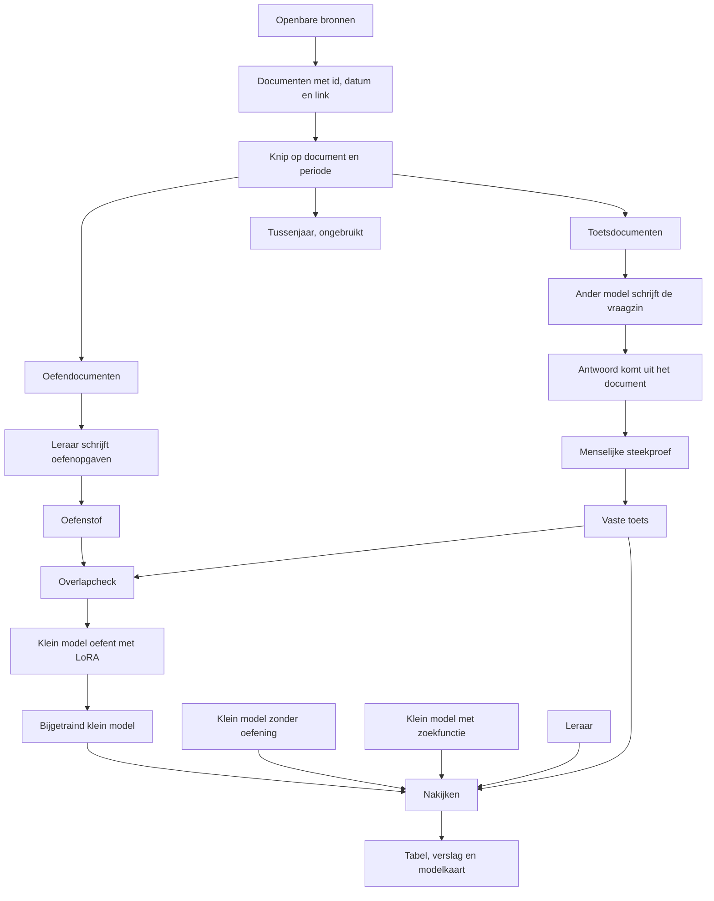

# 07. Benchmark en distillatie

*Koers vanaf 14 november 2026. Dit document wint van de oudere productplannen in [01](01-kritische-beoordeling.md) tot en met [05](05-mvp-ontwikkelplan.md) waar ze elkaar tegenspreken. De modulaire monoliet uit [06](06-architectuur-structuur.md) blijft.*

## De vraag

Kan een klein model, dat op je eigen computer draait, een vaste toets over de Tweede Kamer en de rijksoverheid beter maken dan hetzelfde model zonder extra oefening? En komt het in de buurt van een veel groter model?

De oefenopgaven schrijft dat grote model. Het kleine model oefent daarmee. De toets komt uit andere documenten, uit een andere periode, en de vraagzinnen schrijft een ander model. Zo meten we het oefenen, en niet of het kleine model de antwoorden al heeft gezien.

Het publieke resultaat is een tabel, een bijsluiter bij de data, het kleine modelbestand en een kort verslag in gewone taal. Het verslag noemt ook de onderdelen waar het kleine model slechter blijft.

Dit is een onderzoek in deze repo. Het is geen vergunningchecker en geen chatproduct voor burgers. De demo van 6 december 2026 vervalt.

## Wat er al staat, en wat stopt

Al gebouwd en bruikbaar voor deze koers:

- de repo, CI, Postgres met pgvector, het FastAPI-skelet en het SvelteKit-skelet;
- de BWB-client, de XML-parser, de opslag, de embeddings en het hybride zoeken (dat wordt de zoek-baseline);
- de LLM-aansluiting (lokaal via Ollama, of een OpenAI-compatibel adres);
- een leeg eval-skelet en een lege `training/`-map buiten de uv-workspace.

Dit stopt. De bijbehorende open issues staan in de bijlage, met het voorstel om ze te sluiten of te bevriezen:

- de dakkapel-wizard, de regels-als-code, het conceptdossier en de DSO-indieningsvereisten;
- de burgerchat (SSE, bronnenpaneel, gespreksgeschiedenis, lokaal/cloud-schakelaar);
- omgevingsplan per adres, document-upload en het bezwaarschrift;
- de oude eval-set van vergunningvragen.

`wetvia.rules`, `wetvia.dossier` en `wetvia.documents` blijven lege mappen. Ze staan in het import-linter-contract omdat de mappen bestaan. Er komt geen featurecode in tot een issue die map met naam noemt.

## Begrippenlijst

Korte uitleg, met een alledaags beeld. Verderop gebruik ik het woord zelf.

| Woord | Betekenis | Beeld |
|---|---|---|
| **Basismodel** | Het model zoals je het downloadt, vóór de extra oefening van dit project. | Een nieuwe medewerker op maandagochtend, zonder de map met jullie voorbeelden. |
| **Fine-tunen** | Het model extra laten oefenen op jouw voorbeelden, zodat het die taak vaker goed doet. | Dezelfde medewerker werkt een map nagekeken Kamervragen door. |
| **LoRA** | Een zuinige vorm van fine-tunen. Het grote bestand blijft onaangeroerd. Je traint een dun extra bestand met aanpassingen, en legt dat ernaast. | Een schrift met correcties in de kantlijn, in plaats van het hele handboek te herschrijven. |
| **Leraar** | Het grote model dat de oefenopgaven mét uitwerking schrijft. | Een ervaren collega die voorbeeldantwoorden maakt. |
| **Leerling** | Het kleine model dat met die opgaven oefent. | De nieuwe medewerker. |
| **Distillatie** | De leraar maakt de oefenstof. De leerling oefent tot hij die taak zelf kan, zonder de leraar erbij. | De collega schrijft de oefenmap. Daarna doet de nieuwe medewerker het werk alleen, op een gewone laptop. |
| **Open-weight** | Je mag het modelbestand downloaden en op je eigen machine draaien. De licentie is een tweede vraag: die zegt wat je met de antwoorden mag. | De doos met het apparaat staat bij je thuis. De gebruiksaanwijzing kan alsnog verbieden om er kopieën mee te maken. |
| **Benchmark (toets)** | Een vaste set vragen met een vast antwoord. Elk model krijgt dezelfde vragen. | Een examen dat voor de hele klas hetzelfde is. |
| **Baseline** | De scores waarmee je vergelijkt. Zonder die scores zegt één getal niets. | Het examen van de nieuwe medewerker, van dezelfde persoon mét het archief op tafel, en van de ervaren collega. |
| **RAG** | Het model zoekt eerst echte stukken tekst op en antwoordt daarna met die stukken erbij. De afkorting komt van *retrieval-augmented generation*: zoeken, en dan pas formuleren. | Een open-boek-examen. |
| **Contaminatie** | Oefenstof en toets lopen door elkaar. Het model lijkt slim omdat het de examenvraag al in zijn huiswerk had. | De oefenmap bevat de vragen van het examen van volgende week. |
| **LLM-as-judge** | Een model kijkt de antwoorden van een ander model na, volgens een vast nakijkvoorschrift. Dat nakijken kan zelf fout zijn. Daarom controleert een mens een steekproef. | Een tweede docent kijkt na met een antwoordmodel. De vakgroep leest een stapel na om te zien of die docent streng genoeg is. |
| **Steekproef** | Jij leest een deel van de vragen en vinkt drie dingen af: klopt de link, staat de zin er echt, klopt het antwoord. Je hoeft niet te weten hoe een model werkt. | Een doos appels controleren door er honderd te opensnijden, niet door de sorteermachine te repareren. |
| **Meerkeuze, vast feit, welk document** | Vraagsoorten met één vast antwoord. Een script kan ze nakijken. | Een meerkeuzetoets, een jaartal, of "uit welk stuk komt deze zin". |
| **Synthetische data** | Oefenopgaven die een model heeft geschreven. In dit project komen de bronzin en het juiste antwoord uit het echte document. Het model schrijft alleen de vraagzin of de voorbeeldformulering. | De collega formuleert de vraag. Het paginanummer komt uit het boek, niet uit zijn geheugen. |
| **Datakaart** | Een korte bijsluiter bij de oefenstof: bronnen, welk model schreef de vragen, welke licentie, wat er bewust niet in zit. | Het etiket op de doos. |
| **Hugging Face** | De site waar het modelbestand en de toets gepubliceerd worden, met die bijsluiter. | De plank in de bibliotheek waar anderen het examen en het schrift kunnen pakken. |
| **GGUF** | Het bestandsformaat waarmee Ollama een model lokaal draait. | De export die op de huiscomputer past. |

## De pijplijn

Elk vak hieronder is één fase. Twee of drie zinnen: wat er komt, en waarom het meetelt.

### Fase 0. Koers vastleggen

Deze tekst, de aanpassingen in de README en in de architectuurdocs, en het issuevoorstel in de bijlage. Er worden in deze fase geen issues gesloten of hernoemd.

Waarom: de coding-bot pakt elk issue met het label `agent-ready` meteen op. Zolang de oude vergunningsissues dat label hebben, bouwt hij de oude assistent. De bijlage zegt welk label eraf moet. Dat doet een mens, na het lezen van deze tekst.

Geld: €0. Tijd: de review van deze PR.

### Fase 1. Documenten verzamelen

Clients voor Kamerstukken (Tweede Kamer open data) en voor Handelingen en beleidsstukken (officiële bekendmakingen). Wetten blijven via de BWB-client die er al is. Elk document krijgt een id, een datum, een titel, een url en de tekst. Tests gebruiken opgenomen antwoorden van de echte API. CI belt de overheid niet.

Waarom: een vraag zonder een pagina die je kunt openen telt niet. De eerste publiceerbare tabel mag op Kamerstukken alleen rusten. Handelingen, wetten en beleidsstukken volgen hetzelfde schema en komen erbij zodra hun client er is. Het verslag zegt welke bronnen in het getal zitten.

Geld: €0, de bronnen zijn open. Tijd: ongeveer een uur om een paar echte links te openen en te zien of titel en datum kloppen.

### Fase 2. Oefenen en toets uit elkaar houden

Een export knipt de documenten in twee bestanden. Oefenen: publicatiedatum vóór 1 januari 2024. Toets: 1 januari 2025 tot en met 30 september 2026, en die einddatum blijft vast tot het verslag er is. Heel 2024 gaat in geen van beide bestanden. Dat tussenjaar vangt stukken op die nét over de jaargrens op elkaar lijken.

Een Kamerzaak blijft bij elkaar. Heeft een zaak stukken aan beide kanten van de knip, dan volgt de hele zaak de datum van het oudste stuk. Valt dat oudste stuk in 2024, dan blijft de hele zaak ongebruikt. Wetten leven door onder hetzelfde BWB-id. Daar beslist de geciteerde zin: staat die zin ook in een oefen-toestand, dan komt hij niet in de toets.

Waarom: anders meet de tabel of de leerling de toets al heeft gezien. De overlapcheck is een script dat de run stopt. Het is geen good intent.

Geld: €0. Tijd: een half uur om deze datums te bevestigen of in deze tekst te wijzigen vóór het knip-issue start.

### Fase 3. De toets bouwen

Een nieuw pakket `packages/nl-overheid-benchmark`. Het importeert `wetvia` niet. De code is Apache-2.0, de vragen zijn CC BY 4.0, net als `eval/data/`.

Elk item heeft een type, een vraag, een vast antwoord, de bron-url, het document-id en de letterlijke zin of het veld waar het antwoord uit komt. Drie types kan een script nakijken:

- **Welk stuk of welk artikel.** De zin komt uit het document. Het antwoord is het id of het artikelnummer uit de metadata. De foute opties zijn echte id's uit andere documenten.
- **Vast feit.** Een veld uit de open data, zoals een datum of een stuknummer. Nakijken is: hetzelfde na het opruimen van spaties en het datumformaat.
- **Meerkeuze.** Alleen als het juiste antwoord zo'n veld of zo'n zin is. Geen vraag over "wat zou een jurist hiervan vinden".

Een vierde, kleine set (ongeveer 30 vragen) is open: het model krijgt het stuk erbij en antwoordt in een of twee zinnen. Die set telt pas mee als de nakijker de steekproef haalt (fase 7).

De vraagzin mag van een model komen. Het juiste antwoord mag niet van een model komen. Komt het antwoord niet uit het document, dan bestaat het item niet. Zonder model kan dezelfde mal al een eerste set maken ("In welk stuk staat deze zin?"). Die mal is de reserve als de vraagschrijver uitvalt.

Waarom: een percentage dat een script overrekent, kan iemand anders naspelen. Een mooi klinkend antwoord kan dat niet.

Geld: €0 voor de mal. Tijd: een half uur om het schema te lezen.

### Fase 4. Vraagzinnen, en jouw steekproef

Een ander model dan de leraar herschrijft de vraagzin. Het ziet alleen toetsdocumenten. Daarna lees jij 100 tot 200 items. Per item drie vakjes:

1. De link opent het echte stuk op tweedekamer.nl, officielebekendmakingen.nl of wetten.overheid.nl.
2. De geciteerde zin of het veld staat echt in dat stuk.
3. Het meegegeven antwoord volgt uit die tekst.

Eén nee, en het item gaat eruit. Je hoeft geen prompt te schrijven en geen score te bedenken. Reken ongeveer twee à drie minuten per item, dus zes tot acht uur voor 150 items. Dat is de grootste hap van jouw tijd.

Waarom: een model kan een vloeiende vraag schrijven die naar de verkeerde regel wijst. Alleen de steekproef vangt dat.

Geld: €0 als de vraagschrijver lokaal draait (zie hieronder). Tijd: 6-8 uur, het best in één of twee avonden zodat de lat gelijk blijft.

### Fase 5. Oefenstof door de leraar

De leraar krijgt alleen oefendocumenten. Hij schrijft vragen en een voorbeeldantwoord in het formaat van de toets. Ook hier komt het juiste antwoord uit het document. Een script weigert te starten als de overlapcheck faalt. De datakaart noemt het model, de host, de licentiecitaten, de datums en het aantal weggegooide voorbeelden.

Jij leest daarna ongeveer 40 oefenvoorbeelden met dezelfde drie vakjes. Dat is genoeg om een systematische fout te zien (verkeerde id's, antwoorden die niet in de tekst staan). Het is geen tweede examen.

Waarom: dit is de distillatie. Zonder deze map is er niets om het kleine model mee te oefenen.

Geld: eerst 50 voorbeelden en de rekening bekijken. Een volle ronde van een paar duizend voorbeelden kost naar schatting €5-15 eenmalig, op de prijs van Qwen3.8-27B in [02](02-ai-architectuur.md) (€0,60 per miljoen tokens in, €3,30 uit, Scaleway, Parijs). Langere stukken zitten aan de bovenkant. Die prijs wordt voor de run opnieuw gecontroleerd. De leraar draait niet elke week opnieuw. Tijd: ongeveer twee uur voor de steekproef, plus de run zelf die je niet hoeft te bewaken.

### Fase 6. Het kleine model laten oefenen

Een notebook in `training/notebooks/` traint een LoRA op het 4B-basismodel. Het grote modelbestand blijft staan. Het notebook hervat na een afgebroken sessie. Trainen gebeurt op een gratis GPU van Colab of Kaggle. De RTX 3070 met 8 GB draait het kleine model daarna lokaal, maar traint het niet: volgens [02](02-ai-architectuur.md) vraagt een 4B-LoRA ongeveer 10 GB, een 9B-LoRA ongeveer 22 GB.

Een 8B- of 9B-run is een vervolg, en alleen als de 4B-tabel een verschil laat zien dat de moeite waard is. Die vervolgrun huurt een paar uur een grotere GPU, in de orde van €5-10, binnen het maandbudget van €25. Het gratis aanbod van Colab en Kaggle wisselt. Controleer het op de dag dat je traint.

Waarom: dit is het model waar de onderzoeksvraag over gaat. Eerst het formaat dat gratis past, zodat een mislukte run geen geld kost.

Geld: €0 voor de 4B-run. Tijd: drie tot vijf uur, inclusief één sessie die afbreekt.

### Fase 7. Vier metingen, en de nakijker

Dezelfde toets, vier rijen:

| Rij | Wat er draait | Wat de rij vertelt |
|---|---|---|
| Leerling zonder oefening | Het 4B-basismodel | Het startpunt. |
| Leerling met zoekfunctie | Hetzelfde basismodel, plus de hybride zoekfunctie die er al is | Wat een open boek waard is. Op feiten uit de toetsperiode wint deze rij vaak. Dat publiceren we. |
| Leraar | Het grote model, zonder zoekfunctie | De bovenkant. "In de buurt van de leraar" betekent een percentage van deze score. |
| Leerling na LoRA | Het 4B-model met het extra schrift | De onderzoeksvraag. |

Elke rij draait twee keer. Een keer mét het stuk in de vraag (kan het model de tekst gebruiken?). Een keer zonder (weet het model het uit het hoofd?). De hoofdtabel is de ronde mét het stuk erbij. Daar krijgen leerling, leraar en zoek-baseline dezelfde tekst, en meten we de vaardigheid.

De zoek-baseline mag de toetsdocumenten wél opzoeken. Zoeken op het moment van antwoorden is het punt van een open boek. Die documenten zitten niet in de oefenstof.

De tabel toont de onderdelen waar de bijgetrainde leerling slechter is dan het basismodel of dan de zoek-baseline. Een gemiddelde dat een verlies verstopt, komt niet in het verslag.

De open vragen (ongeveer 30) kijkt een model na met dit voorschrift, en met niets anders: een 1 als het antwoord de vraag beantwoordt en alleen dingen zegt die in het meegegeven stuk staan; een 0 als het een feit toevoegt dat er niet staat, of de vraag ontwijkt. Jij leest al die 30 nakijkbeslissingen. Klopt de nakijker vaak niet, dan blijft de open set buiten de hoofdtabel. Er komt dan een zin in het verslag: de open vragen zijn gemaakt, de nakijker was niet betrouwbaar genoeg.

Waarom: de zin "een percentage van de kwaliteit van het grote model, veel goedkoper, lokaal" is alleen iets waard naast de drie andere rijen, inclusief de verliezen.

Geld: de leraar beantwoordt de toets één keer. Bij een paar honderd vragen blijft dat ruim onder €1 op de prijs uit docs/02. De lokale rijen kosten niets. Tijd: ongeveer twee uur om de tabel te lezen en de 30 nakijkbeslissingen af te vinken.

### Fase 8. Publiceren

Een resultaattabel in `eval/reports/`, de datakaart, een modelkaart die klaar is om op Hugging Face te zetten, en een verslag van een paar bladzijden in gewone taal. De gewichten zelf gaan niet in git. Een kleine demo laat één vraag zien, het antwoord van het bijgetrainde model, de bronlink, en de score van de andere drie rijen op diezelfde vraag. Dat kan een script zijn of één pagina op het bestaande SvelteKit-skelet. Geen wizard en geen dossier.

Waarom: iemand anders moet de tabel kunnen narekenen, en het verslag moet leesbaar zijn zonder deze hele tekst.

Geld: €0. Tijd: drie tot vier uur voor het verslag en de laatste lezing. Het uploaden naar Hugging Face doe je zelf, met een token die niet in de repo komt.

## Modules en grenzen

De monoliet blijft één Python-pakket `wetvia`, met de lagen in `apps/api/pyproject.toml`. Dit plan voegt geen laag toe aan dat contract. import-linter eist dat elke laag die in het contract staat ook als map bestaat. Een laag toevoegen vóór de map er is, maakt CI rood. De nieuwe onderdelen staan daarom buiten `wetvia`, of in een map die al bestaat.

| Onderdeel | Plek | Mag wel | Mag niet |
|---|---|---|---|
| Bronnen ophalen | `packages/nl-wetten-ingest` (Apache-2.0) | HTTP naar de bron-API, fixtures | `wetvia` importeren, vragen verzinnen, opslaan |
| Bronnen bewaren | `wetvia.ingest` (bestaat) | Het bronpakket en `wetvia.db` | De toets of de oefenstof importeren |
| Zoeken | `wetvia.retrieval` en `wetvia.embeddings` (bestaan) | De opgeslagen stukken | Weten welk document bij de toets hoort |
| Modellen aanroepen | `wetvia.llm` (bestaat) | Ollama en een OpenAI-compatibel adres | Zelf de env lezen; dat blijft `bootstrap.py` |
| Toets en overlapcheck | nieuw `packages/nl-overheid-benchmark` | Twee JSONL-bestanden vergelijken en een antwoord naast de sleutel leggen | `wetvia` importeren |
| Nakijken van een modelrun | `eval/` (bestaat) | Het toetspakket, en de publieke zoek-API voor de open-boek-rij | Torch, de oefenstof genereren |
| Oefenstof schrijven | `training/generate/`, buiten de uv-workspace | Het oefen-JSONL-bestand | Het toetspakket, de toets-export |
| Trainen | `training/notebooks/` | Het oefenbestand en Unsloth | De toets lezen |
| Demo | bestaand `apps/web`, pas in fase 8 | `wetvia.llm` en, als de pagina zoekt, `wetvia.retrieval` | `rules`, `dossier`, `documents` |

`training/` blijft buiten de uv-workspace. Torch en Unsloth delen geen lockfile met de API. Dat staat al in de README.

De scheiding tussen oefenen en toets zit niet alleen in een afspraak. Het toetspakket kent de API niet. De trainingsmap kent het toetspakket niet. De overlapcheck leest twee bestanden en stopt bij een gedeeld id, een gedeelde Kamerzaak of een geciteerde zin die aan beide kanten voorkomt.

## Licenties van de leraar

Een open modelbestand is niet genoeg. Drie teksten moeten kloppen, en ze staan letterlijk op de datakaart vóór de eerste betaalde aanroep:

1. de licentie van de gewichten;
2. de zin over wat je met de antwoorden mag doen;
3. de voorwaarden van de host, als het model via een API komt. Een host mag strengere regels plakken op een model dat zelf ruim is.

Stand op 14 november 2026. Controleer de tekst opnieuw op de dag dat je kiest. Dit is een leeslijst, geen juridisch advies.

| Rol | Voorstel | Waarom dit voorstel |
|---|---|---|
| Leerling | Qwen3.5-4B, het kleine model uit [02](02-ai-architectuur.md). De modelkaart daar heet Apache-2.0. | Past in de gratis GPU voor het oefenen, en daarna op de 3070 om te draaien. |
| Leraar | Een groot Qwen-instructiemodel waarvan de kaart Apache-2.0 zegt en niets verbiedt over trainen op antwoorden. Eerste kandidaat: Qwen3.8-27B, omdat docs/02 daar al een prijs en een EU-host voor noemt. | Apache-2.0 zelf zwijgt over antwoorden. Dat is de ruimste grond die we hebben. De host moet die ruimte ook laten. |
| Vraagschrijver | Ministral 3 8B, lokaal via Ollama, mits de modelkaart van dat checkpoint Apache-2.0 is. De helpdesk van Mistral noemt Apache-2.0 voor de meeste open modellen; het Ministral 3-paper noemt die licentie ook. Sommige andere Mistral-gewichten hebben een aangepaste MIT-tekst. De kaart van dit checkpoint wint. | Andere familie dan de leraar, en hij past op de 3070, dus deze stap kost geen cloud. |
| Nakijker | Dezelfde lokale Ministral, alleen voor de ongeveer 30 open vragen, met het vaste voorschrift uit fase 7. | Hij is niet de leerling en niet de leraar, dus hij keurt niet zijn eigen rij in de tabel. Jij leest elke beslissing. |

Niet als leraar gebruiken:

- **OpenAI, Anthropic en de Gemini-API.** Hun voorwaarden verbieden om antwoorden te gebruiken om een concurrerend model te trainen. Overzicht met data: [distil.md](https://distil.md/distillation-license) (geraadpleegd 14 november 2026). De bindende tekst is die van de aanbieder zelf.
- **Llama 3.** De Community License, artikel 1.b.v, verbiedt om de uitvoer te gebruiken om een ander taalmodel te verbeteren. Tekst: [llama.com/llama3/license](https://www.llama.com/llama3/license/).
- **Llama 4** staat distillatie toe, en eist daarna dat de naam van het gepubliceerde model met "Llama" begint en dat "Built with Llama" zichtbaar is ([Llama 4 license, 1.b.i](https://github.com/meta-llama/llama-models/blob/main/models/llama4/LICENSE)). Dat botst met een leerling die een gewoon open model moet blijven. Daarom geen leraar.
- **Gemma.** Een model dat op Gemma-antwoorden traint, valt onder hun begrip *Model Derivative* en erft het gebruiksverbod, inclusief beperkingen rond juridische beroepsuitoefening ([Gemma Terms](https://ai.google.dev/gemma/terms), geraadpleegd 14 november 2026). Ongeschikt als leraar voor deze toets. Docs/02 noemt Gemma 4 als Apache-2.0-kandidaat voor de oude bake-off. Die zin gaat over draaien, niet over als leraar gebruiken. De kaart van het concrete checkpoint wint.
- **De commerciële Mistral-API** als leraar. De voorwaarden van 25 september 2026 verbieden in §3.3 alleen het trainen van een concurrerende beeldgenerator op beeldantwoorden ([tekst](https://legal.mistral.ai/terms/commercial-terms-of-service/)). Voor tekst staat er geen zo'n zin. We gebruiken de API toch niet als leraar: de lokale Apache-gewichten van Ministral zijn de vraagschrijver, en een API-tekst kan bij een volgende versie dichtgaan.

DeepSeek-R1 staat als MIT bekend en noemt distillatie in de modelkaart. Dat kan later een tweede leraar zijn, als een kleine proef laat zien dat het Nederlands van Kamerstukken goed genoeg is. Niet de startkeuze.

## Geld en tijd

Budget: ongeveer €0-25 per maand aan cloud, en 5-10 uur per week.

| Fase | Cloud | Jouw uren | Kan een bot de code doen? |
|---|---|---|---|
| 0. Deze tekst | €0 | review | de tekst wel, de issue-labels niet |
| 1. Documenten | €0 | 1 | ja |
| 2. Knip | €0 | 0,5 | ja, nadat de datums blijven staan |
| 3. Toetspakket | €0 | 0,5 | ja |
| 4. Vraagzinnen + steekproef 100-200 | €0 lokaal | 6-8 | het script wel, de vakjes niet |
| 5. Oefenstof | €5-15 eenmalig, eerst 50 stuks | 2 | het script wel, de 40 voorbeelden niet |
| 6. LoRA 4B | €0 op Colab of Kaggle | 3-5 | het notebook wel, de GPU-sessie niet |
| 6b. LoRA 8B, alleen bij winst | €5-10 eenmalig | 2 | hetzelfde |
| 7. Vier metingen | onder €1 voor de leraar op de toets | 2 | de runner wel, het lezen van de 30 nakijkbeslissingen niet |
| 8. Verslag en demo | €0 | 3-4 | een concept wel, de laatste lezing en de upload niet |

De steekproef is de piek. De rest past in de gewone 5-10 uur, met de bots op de scripts. Een maand zonder leraar-run en zonder gehuurde GPU kost €0.

## Wat deze toets niet bewijst

- Hij bewijst niet dat het kleine model een jurist is, of dat een burger er een vergunning mee moet voorbereiden.
- De hoofdtabel bewijst niet dat het model feiten uit het hoofd kent. Die vraag hoort bij de ronde zonder stuk in de prompt. Daar wint de zoekfunctie vaak, en dat getal komt in het verslag.
- De knip houdt onze eigen oefenstof uit de toets. Hij houdt niet tegen dat de leraar een Kamerstuk ooit op internet heeft gezien. Dat staat in het verslag.
- Een hoge score op "in welk stuk staat deze zin" zegt niets over vrije juridische adviezen.

## Bijlage. Voorgestelde issues

Dit is een voorstel. Er is nog geen issue aangemaakt, gesloten of herlabeld. De bot pakt `agent-ready` meteen op. Haal dat label eerst van de oude issues af, en zet het pas op een nieuw of herschreven issue als de tekst daarvan klopt met deze bijlage.

### Al gemerged, code blijft

[#1](https://github.com/lucasabella/wetvia-ai/issues/1), [#2](https://github.com/lucasabella/wetvia-ai/issues/2), [#3](https://github.com/lucasabella/wetvia-ai/issues/3), [#4](https://github.com/lucasabella/wetvia-ai/issues/4), [#5](https://github.com/lucasabella/wetvia-ai/issues/5), [#7](https://github.com/lucasabella/wetvia-ai/issues/7), [#8](https://github.com/lucasabella/wetvia-ai/issues/8), [#9](https://github.com/lucasabella/wetvia-ai/issues/9), [#10](https://github.com/lucasabella/wetvia-ai/issues/10), [#11](https://github.com/lucasabella/wetvia-ai/issues/11), [#12](https://github.com/lucasabella/wetvia-ai/issues/12), [#14](https://github.com/lucasabella/wetvia-ai/issues/14) en [#38](https://github.com/lucasabella/wetvia-ai/issues/38). Niet opnieuw openen.

### Open issues

| Issue | Voorstel | Reden |
|---|---|---|
| [#6](https://github.com/lucasabella/wetvia-ai/issues/6) | Herschrijven | Nu een bake-off voor de vergunningschat. Wordt: past het 4B-model op een gratis Colab-GPU en daarna op de 3070, en hoe lang duurt één antwoord. Geen kwaliteitscijfer. Label `agent-ready` eerst af. |
| [#13](https://github.com/lucasabella/wetvia-ai/issues/13) | Sluiten | 80 vergunningvragen. De steekproef hieronder vervangt dit. |
| [#15](https://github.com/lucasabella/wetvia-ai/issues/15) | Houden, bevriezen | De antwoordpipeline kan later de demo voeden. Nu niet bouwen. Label af. |
| [#16](https://github.com/lucasabella/wetvia-ai/issues/16) | Houden, bevriezen | De citatiecheck hoort bij de demo, niet bij de eerste tabel. Label af. |
| [#17](https://github.com/lucasabella/wetvia-ai/issues/17) | Sluiten | SSE-chat van de oude assistent. |
| [#18](https://github.com/lucasabella/wetvia-ai/issues/18) | Sluiten | Chatscherm. De demo is een nieuw, klein issue. |
| [#19](https://github.com/lucasabella/wetvia-ai/issues/19) | Sluiten | Gespreksgeschiedenis is niet nodig voor de tabel. |
| [#20](https://github.com/lucasabella/wetvia-ai/issues/20) | Sluiten | Schakelaar lokaal/cloud voor een gebruiker. De leraar blijft een scriptinstelling. |
| [#21](https://github.com/lucasabella/wetvia-ai/issues/21) | Sluiten | Dakkapelregels in code. |
| [#22](https://github.com/lucasabella/wetvia-ai/issues/22) | Sluiten | Dakkapel-wizard. |
| [#23](https://github.com/lucasabella/wetvia-ai/issues/23) | Sluiten | Conceptdossier. |
| [#24](https://github.com/lucasabella/wetvia-ai/issues/24) | Sluiten | DSO-indieningsvereisten. |
| [#25](https://github.com/lucasabella/wetvia-ai/issues/25) | Sluiten | Wekelijkse controle op dakkapeldrempels. |
| [#26](https://github.com/lucasabella/wetvia-ai/issues/26) | Sluiten | 150 vergunningvragen en een externe jurist. De nieuwe steekproef doe je zelf. |
| [#27](https://github.com/lucasabella/wetvia-ai/issues/27) | Herschrijven | Blijft het issue voor het toetspakket en de automatische score. Label af tot de tekst klopt. |
| [#28](https://github.com/lucasabella/wetvia-ai/issues/28) | Houden, bevriezen | Eval in CI pas als de toets stabiel is. Label af. |
| [#29](https://github.com/lucasabella/wetvia-ai/issues/29) | Sluiten | Toegankelijkheidspass van het oude scherm. Opnieuw bekijken bij de demo. |
| [#30](https://github.com/lucasabella/wetvia-ai/issues/30) | Herschrijven | Wordt het verslag, de datakaart en de Hugging Face-tekst. De video van 6 december vervalt. |
| [#31](https://github.com/lucasabella/wetvia-ai/issues/31) | Sluiten | Omgevingsplan per adres. |
| [#32](https://github.com/lucasabella/wetvia-ai/issues/32) | Sluiten | Document-upload. |
| [#33](https://github.com/lucasabella/wetvia-ai/issues/33) | Sluiten | Bezwaarschrift. |
| [#34](https://github.com/lucasabella/wetvia-ai/issues/34) | Herschrijven | Blijft het issue voor de oefenstof en de datakaart. Label af tot de tekst klopt. |
| [#35](https://github.com/lucasabella/wetvia-ai/issues/35) | Herschrijven | Blijft het LoRA-notebook. Eerst 4B. Label af tot de tekst klopt. |
| [#39](https://github.com/lucasabella/wetvia-ai/issues/39) | Houden, bevriezen | De TypeScript-client wacht op een echte UI. Label af. |
| [#47](https://github.com/lucasabella/wetvia-ai/issues/47) | Herschrijven | Blijft de vergelijking van de vier rijen, inclusief de verliezen. Label af tot de tekst klopt. |

De milestones M2 tot en met M6 horen bij de oude assistent. Die kan je sluiten of hernoemen als je de issues hierboven verwerkt. Deze PR doet dat niet.

### Nieuwe issues

Nog niet aanmaken. Volgorde is de werkvolgorde. Een issue krijgt `agent-ready` pas als de issues waar het van afhangt bestaan en de oude labels eraf zijn.

| Nr | Titel | Label | Hangt af van | Wat het is |
|---|---|---|---|---|
| A | Licentieblad: leraar, vraagschrijver, leerling, nakijker | `needs-human` | deze tekst | Jij plakt de licentiecitaten en de host-voorwaarden. Geen betaalde aanroep. |
| B | Kamerstukken ophalen uit de Tweede Kamer open data | `agent-ready` | label-bevriezing | Client plus opslag, met id, zaak-id, datum, titel, url en tekst. |
| C | Handelingen en beleidsstukken uit officiële bekendmakingen | `agent-ready` | label-bevriezing, parallel aan B | Zelfde velden, documenttype erbij. |
| D | Export, knip en overlap op documenten | `agent-ready` | B, datums uit fase 2 | Twee JSONL-bestanden. Een gedeeld id of een gedeelde zaak stopt de run. |
| E | Vraagzinnen door het andere model | `agent-ready` | A, en het herschreven #27 | Alleen de zin. Het antwoord blijft het veld uit het document. Alleen toetsdocumenten. |
| F | Steekproef van de toets, 100 tot 200 items | `needs-human` | E | De drie vakjes uit fase 4. |
| G | Steekproef van de oefenstof, ongeveer 40 items | `needs-human` | herschreven #34 | Dezelfde drie vakjes. |
| H | Nakijker controleren op de open vragen | `needs-human` | herschreven #47 | Jij leest elke nakijkbeslissing van de ongeveer 30 open vragen. |
| I | Kleine demo van één vraag | `agent-ready` | herschreven #47 | Eén vraag, vier antwoorden of scores, bronlink. Geen wizard. |

Acceptatie, zodat een later issue letterlijk overgenomen kan worden:

**A. Licentieblad** (`needs-human`)

- [ ] Voor leerling, leraar, vraagschrijver en nakijker staan het exacte model, de versie, de licentie-URL en een citaat.
- [ ] De leraar-tekst verbiedt niet om een ander model op de antwoorden te trainen. De host-tekst evenmin.
- [ ] De vraagschrijver is een ander model dan de leraar.
- [ ] Er is nog geen betaalde API-aanroep gedaan.

**B. Kamerstukken** (`agent-ready`)

- [ ] De client staat in `packages/nl-wetten-ingest` en importeert `wetvia` niet.
- [ ] Opslag staat in `wetvia.ingest`.
- [ ] Een opgenomen API-antwoord (fixture) levert id, zaak-id, datum, titel, url en tekst. De test doet geen netwerkcall.
- [ ] Er zitten geen verzonnen wetteksten en geen toetsvragen in de PR.

**C. Handelingen en beleidsstukken** (`agent-ready`)

- [ ] Zelfde grens als B. Endpoint zoals in [04](04-tech-stack.md): de SRU-zoekdienst van officiële publicaties.
- [ ] Het record heeft een documenttype.
- [ ] Fixture, geen live netwerk in de test.

**D. Export en knip** (`agent-ready`)

- [ ] De datums zijn die uit fase 2, op één plek in de code.
- [ ] Een Kamerzaak met stukken aan beide kanten valt in zijn geheel aan de kant van het oudste stuk. Valt dat stuk in 2024, dan zit de zaak in geen van beide exports.
- [ ] 2024 zit in geen van beide exports.
- [ ] Een test met fictieve id's (geen echte wetstekst) stopt bij overlap van id of zaak.
- [ ] Voor wetten: een geciteerde zin die in een oefen-toestand staat, mag niet in de toets-export belanden. De test gebruikt een fixture, geen verzonnen artikel.

**E. Vraagzinnen** (`agent-ready`)

- [ ] Invoer is alleen de toets-export.
- [ ] Het script weigert te draaien als het model gelijk is aan de leraar op het licentieblad.
- [ ] Het antwoordveld wordt niet door het model overschreven.
- [ ] De sleutel blijft in de repo als concept staan tot issue F hem afvinkt. Concept-items tellen niet als score.

**F. Steekproef toets** (`needs-human`)

- [ ] 100 tot 200 items hebben drie antwoorden: link klopt, zin staat er, antwoord volgt uit de tekst.
- [ ] Elk nee haalt het item uit de set.
- [ ] Wat overblijft, verliest het concept-vlaggetje.

**G. Steekproef oefenstof** (`needs-human`)

- [ ] Ongeveer 40 voorbeelden, dezelfde drie vakjes.
- [ ] Een herhaalde fout (bijvoorbeeld steeds een verkeerd id) stopt de volle generatieronde tot het script is verbeterd.

**H. Nakijker** (`needs-human`)

- [ ] Elke nakijkbeslissing van de open set is door een mens gezien.
- [ ] Bij structurele missers blijft de open set buiten de hoofdtabel, met een zin daarover in het rapport.

**I. Demo** (`agent-ready`)

- [ ] Eén voorbeeldvraag uit de gepubliceerde toets, met bronlink.
- [ ] De pagina of het script toont het bijgetrainde antwoord en de scores van de andere drie rijen op die vraag.
- [ ] Geen `wetvia.rules`, `wetvia.dossier` of `wetvia.documents`.
- [ ] Geen nieuw cijfer: de demo leest de tabel uit fase 7.

Herschreven issues, in het kort, zodat hun nieuwe acceptatie niet zoekraakt:

**#6**, na herschrijven (`agent-ready`): een meting zonder kwaliteitscijfer. Het 4B-model laadt in een gratis Colab- of Kaggle-sessie en, apart, via Ollama op de 3070. Het rapport zet tijd-tot-eerste-token en tokens per seconde, of "niet gemeten" als de GPU er niet is. Geen verzonnen snelheid. Geen modeldownload in CI.

**#27**, na herschrijven (`agent-ready`, hangt af van D): het pakket `packages/nl-overheid-benchmark` bestaat, importeert `wetvia` niet, en scoort meerkeuze, vast feit en welk-stuk tegen de sleutel. De overlapfunctie vergelijkt twee exports. `eval/` roept die score aan. Een lege of concept-set schrijft "niet gemeten".

**#34**, na herschrijven (`agent-ready`, hangt af van A en D): `training/generate/` leest alleen de oefen-export, weigert bij een falende overlapcheck, en schrijft een datakaart. Geen toetsimport. Eerst een droge run op 50 fixtures of 50 echte stukken, zonder de volle ronde stilzwijgend te starten.

**#35**, na herschrijven (`agent-ready` voor het notebook, de GPU-sessie is van jou, hangt af van #34): notebook voor een 4B-LoRA dat kan hervatten. Geen gewichten in git. Een test of een dry-run zonder GPU controleert de datalader op een tiny fixture.

**#47**, na herschrijven (`agent-ready` voor de runner, hangt af van #27 en #35): de vier rijen, twee rondes (met en zonder stuk in de vraag). Het rapport heeft een plek voor "hier is het kleine model slechter". De zoek-rij gebruikt de publieke retrieval-API. Concept-items tellen niet mee.

**#30**, na herschrijven (`needs-human`, hangt af van #47 en F): het verslag in gewone taal, de tabel, de datakaart, en een modelkaart-tekst. Jij uploadt. Het verslag noemt de bronnen die in het getal zitten en de grenzen uit "Wat deze toets niet bewijst".
